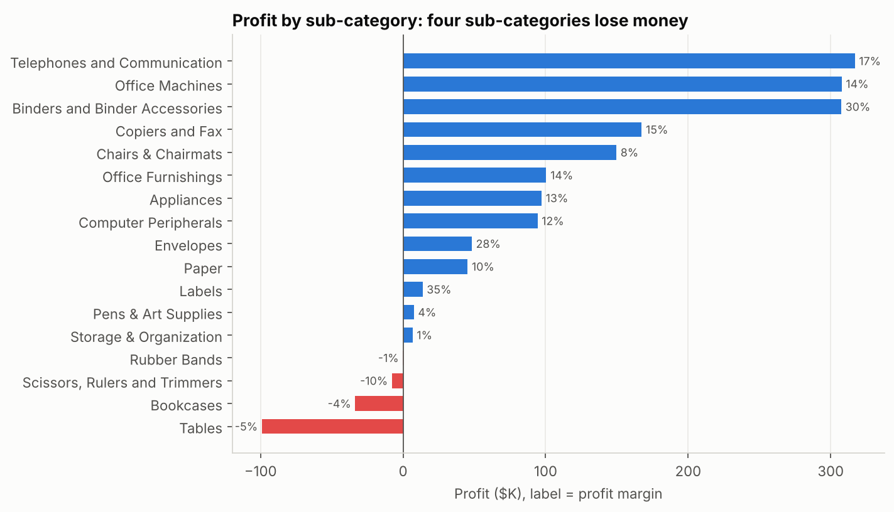
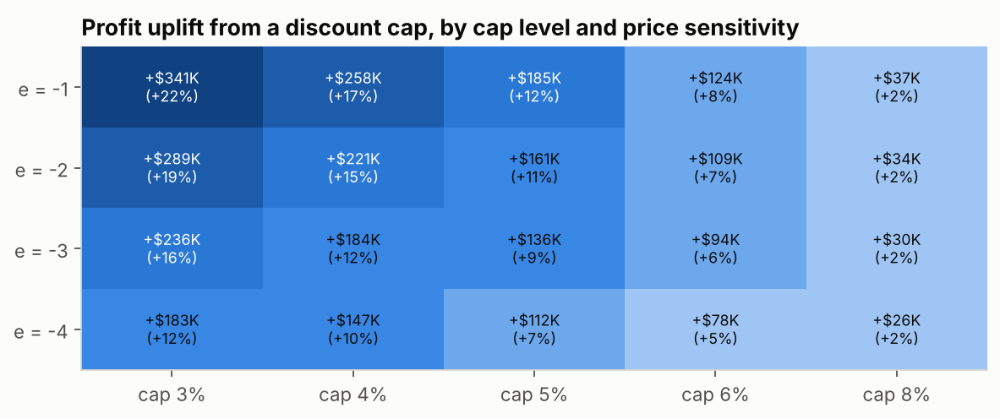

# Superstore Profit Leakage: Discounts, Product Mix and a Discount-Cap Policy

**Profitability analysis of 8,399 retail order lines: finding where profit leaks and sizing a discount policy, delivered as SQL, a Python notebook and a live-formula Excel model for stakeholders.**

`SQL (DuckDB / PostgreSQL syntax)` · `Python (pandas)` · `Excel what-if model` · `Pricing scenario analysis`

---

## Business problem

An office-supplies retailer made **$14.92M in sales but only $1.52M profit (10.2% margin)** over 2009–2012, and the margin fell to 9.2% in 2012. Leadership asked:

1. Which products and order types lose money?
2. Are discounts the cause, or just a symptom of product mix?
3. What discount policy would recover profit, and how much revenue would it cost?

## Data

Tableau *Superstore Sales* sample (Canada): 8,399 order lines, 5,496 orders, 795 customers, Jan 2009 to Dec 2012. No duplicates and no missing values in the columns used.

## Approach

| Step | What was done |
|---|---|
| KPI baseline (SQL) | Sales, profit, margin and average discount by year |
| Profit leakage (SQL) | Profit by sub-category; share of loss-making order lines |
| Discount impact (SQL) | Margin by discount band, then a **mix-adjusted comparison**: high vs low discount *within* each sub-category, weighted by sales |
| Operational checks | Margin by ship mode × category and by order priority |
| Scenario model (Python) | Discount cap with a price-elasticity assumption, tested across a 5 × 4 grid of caps and elasticities |
| Break-even pricing | Price rise needed for each loss-making sub-category to reach zero margin |
| Excel model | 8,399 lines with 50,000+ live formulas; inputs = cap, elasticity, on/off switch per sub-category. **Matches the Python model to the dollar** ($160,772 uplift) |

## Key findings

| Finding | Value |
|---|---|
| Loss-making order lines | **50.8%** ($1.10M of losses offsetting $2.62M of gains) |
| Loss-making sub-categories | 4 (Tables, Bookcases, Scissors/Rulers, Rubber Bands): **−$141K** combined; Tables alone −$99K |
| Margin gap, lines discounted > 5% vs ≤ 5% in the same sub-category | **−4.4 pp** (discounts hurt margin in 15 of 17 sub-categories) |
| Furniture shipped by Delivery Truck | −0.2% margin (vs 12.1% by Regular Air). The cause is bulky low-margin products, not the truck |
| "Critical" priority orders | 6.7% margin vs 12.5% for "High" priority |



## Recommendation: cap discounts at 5%



| Scenario (elasticity −2) | Profit uplift | Sales change |
|---|---|---|
| **5% cap, all sub-categories** | **+$161K (+10.6%)** | −1.5% |
| 5% cap, furniture excluded | +$94K (+6.2%) | −1.0% |

The cap changes 44% of order lines. Even if customers are very price-sensitive (e = −4), the 5% cap still adds $112K.

**Fix pricing on the loss-makers.** Holding volume constant, Tables need a +5.2% price rise and Bookcases +4.1% just to break even. Category managers should renegotiate supplier cost or reprice these lines.

**Review "Critical" priority handling.** These orders earn about half the margin of other priorities, which suggests expedite costs are not being passed on.

## Excel model

[`excel/discount_policy_model.xlsx`](excel/discount_policy_model.xlsx) has three sheets:

- **Inputs:** discount cap, price elasticity, and a Y/N switch per sub-category (blue cells on yellow)
- **Summary:** current vs new sales, profit and margin by sub-category, plus headline uplift
- **Order Lines:** the 8,399 lines with the formulas for in-scope flag, new discount, price ratio, volume factor, new sales and new profit

Rebuild it at any time with `python src/build_excel_model.py`.

## Repository structure

```
├── data/download_data.py               # downloads superstore.csv into data/raw/
├── excel/discount_policy_model.xlsx    # live-formula what-if model
├── notebooks/01_profit_leakage_analysis.ipynb
├── reports/figures/
├── sql/analysis_queries.sql            # all business queries (named blocks)
└── src/
    ├── discount_model.py               # scenario model used by notebook + Excel builder
    ├── build_excel_model.py
    └── style.py
```

## How to run

```bash
pip install -r requirements.txt
python data/download_data.py
jupyter notebook notebooks/01_profit_leakage_analysis.ipynb
```

## Limitations

- Elasticity is an assumption, not an estimate; the grid shows how much the answer depends on it. A pricing test on one region would turn it into a measured number.
- The Superstore data is a well-known sample dataset, so it shows the method rather than a real company's figures.
